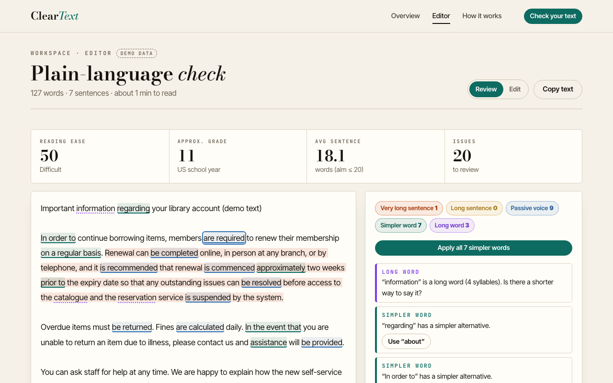
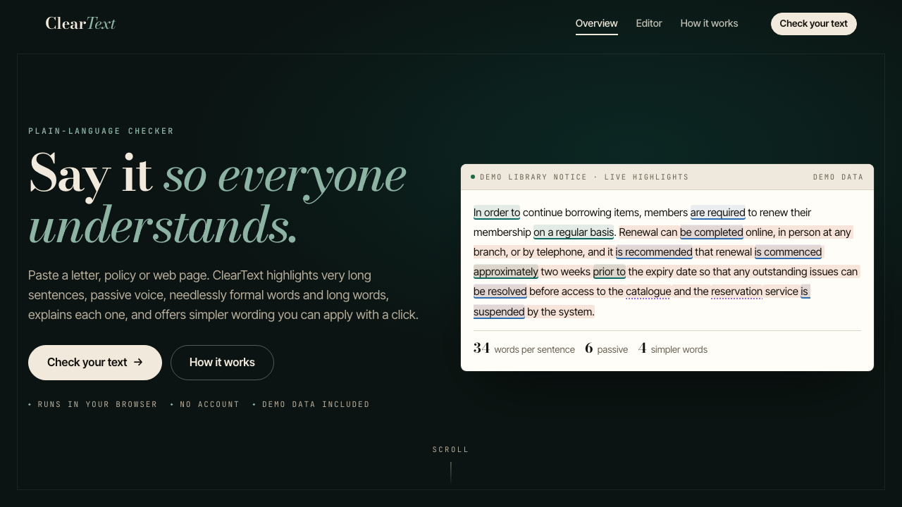
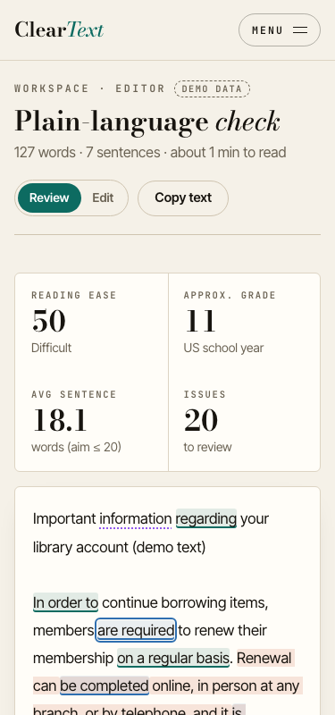

# ClearText

A plain-language checker. Paste text and ClearText highlights very long and long sentences, possible passive voice, formal words with simpler alternatives, and long words — explains each one, offers one-click replacements, and estimates readability.

**Live demo:** [https://kavishtolani.github.io/cleartext/](https://kavishtolani.github.io/cleartext/) — runs entirely in your browser; demo data is fictional and labelled.



| Landing | Mobile |
| --- | --- |
|  |  |

## Run it

```bash
npm install
npm run dev        # http://localhost:5128
npm test
npm run build
npm run test:e2e   # Playwright smoke test (npm run e2e:install once if Chromium is missing)
```

## Main workflow

1. **Editor** opens with a labelled demo library notice that triggers every check. Clearing the text shows the empty state.
2. **Review** mode colour-codes issues in the text (sentence backgrounds for length; underlines for passive voice, simpler words and long words). Click a highlight to select its explanation, or a finding to highlight it.
3. Toggle issue types on/off with the coloured chips (each shows a count).
4. **Use “…”** replaces one formal word/phrase (keeping capitalisation); **Apply all N simpler words** replaces them all.
5. **Edit** mode for rewriting; stats (reading ease and label, approximate grade, average sentence length, issue count) update as you type. **Copy text** when done.

## How the checks work

See the in-app **How it works** page. Sentences > 25 words are long, > 35 very long; passive voice = a form of “be” + past participle; 50+ formal words/phrases have plain alternatives; long words are ≥ 9 letters and ≥ 4 estimated syllables; Flesch reading ease and Flesch–Kincaid grade use estimated syllables.

## Tests

- `src/lib/analyze.test.ts` — sentence splitting with abbreviations and decimals, syllable estimates, passive voice (including a documented false positive), plain-word suggestions with case, long sentences, readability labels, applying suggestions, empty text.
- `src/App.test.tsx` — demo findings, apply one and apply all, type filters, edit to a clean result, empty state.
- `e2e/smoke.spec.ts` — click a passive highlight to select its finding, apply all, edit mode, reload persistence; strict 375px checks.

## Limitations

- English only; all checks are heuristics with false positives (e.g. “she is tired” looks passive) and false negatives.
- Readability formulas are rough and were designed for continuous prose, not lists or headings.
- No grammar or spelling checking; no rewriting of whole sentences.

## Future improvements

- Custom word lists per organisation, sentence-split suggestions, and exporting a review summary.

## Licence

MIT — see [LICENSE](LICENSE).
